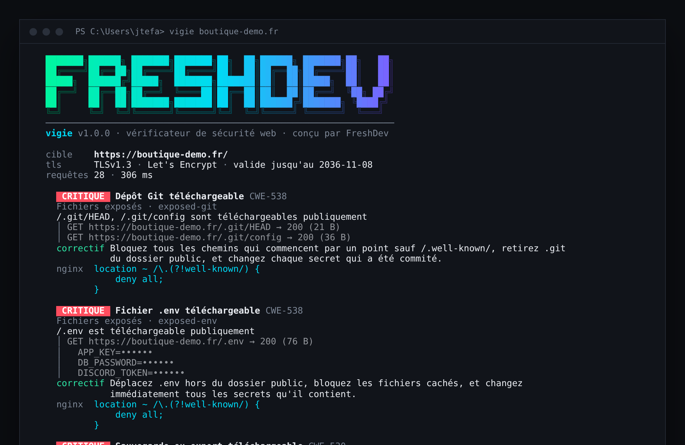
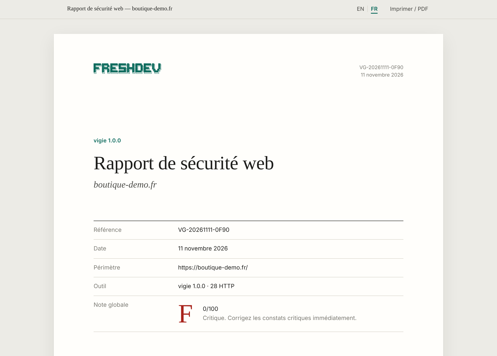
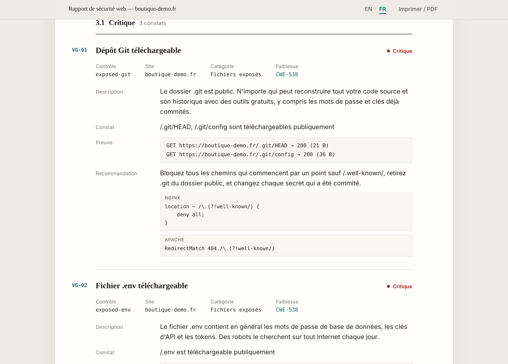

<div align="center">

# vigie

**Vérifie la sécurité de n'importe quel site web en quelques secondes, avec un rapport que ton client peut lire.**

[](https://www.npmjs.com/package/vigie)
[](https://github.com/FreshlapeufDev/vigie/actions/workflows/ci.yml)
[](https://nodejs.org)
[](https://github.com/FreshlapeufDev/vigie/blob/main/LICENSE)

HTTPS · certificats · en-têtes de sécurité · cookies · fichiers exposés · bibliothèques vulnérables

[English](https://github.com/FreshlapeufDev/vigie/blob/main/README.md) · **Français**



</div>

## Pourquoi

La plupart des sites ne se font pas pirater par des attaques sophistiquées. Ils se font pirater parce qu'un fichier `.env` est téléchargeable, que le dossier `.git` est public, qu'une sauvegarde traîne dans le dossier du site, que les cookies circulent sans `Secure`, ou qu'un jQuery vieux de dix ans tourne encore sur la page d'accueil.

Des robots cherchent ces erreurs sur tout Internet, chaque jour. vigie les trouve avant eux, explique chacune simplement et donne la ligne exacte de configuration nginx ou Apache qui la corrige.

## Installation

Il faut [Node.js](https://nodejs.org) 18 ou plus récent (prends la version **LTS**).

```bash
npm install -g vigie
```

ou lance-le une seule fois sans rien installer :

```bash
npx vigie exemple.fr
```

## Utilisation

```bash
vigie exemple.fr
vigie https://boutique.exemple.fr --html audit.html
vigie exemple.fr blog.exemple.fr --lang fr
```

| Option | |
|---|---|
| `--html <fichier>` | rapport d'audit autonome en français et en anglais |
| `--json` | sortie exploitable par d'autres outils |
| `--lang <fr\|en>` | langue de la sortie (par défaut : langue du système) |
| `--fail-under <note>` | code de sortie `1` sous cette note, pour l'intégration continue |
| `--no-probe` | lire seulement la page d'accueil, sans chercher de fichiers exposés |
| `--timeout <secondes>` | délai par requête (`10` par défaut) |
| `-q, --quiet` | résumé uniquement |
| `--no-banner` | masquer le logo FreshDev |

## Ce qui est vérifié

| Sévérité | Contrôle | Ce qui est détecté |
|---|---|---|
| critique | `no-https` | le site n'a pas de HTTPS fonctionnel |
| critique | `tls-invalid-cert` | certificat expiré, auto-signé, incomplet ou émis pour un autre domaine |
| critique | `exposed-git` | `/.git/` téléchargeable : tout le code source et son historique |
| critique | `exposed-env` | `.env`, `.env.local`, `.env.production` téléchargeables |
| critique | `exposed-backup` | exports `.sql`, archives `.zip`, `wp-config.php.bak`… |
| critique | `exposed-config` | `.vscode/sftp.json`, `.npmrc`, `docker-compose.yml` avec des secrets |
| critique | `exposed-htpasswd` | fichier des mots de passe des zones protégées |
| élevée | `tls-old-protocol` | le serveur accepte encore TLS 1.0 ou 1.1 |
| élevée | `http-no-redirect` | `http://` affiche le site au lieu de rediriger |
| élevée | `cors-reflected-origin` | n'importe quel site peut lire les réponses des visiteurs connectés |
| élevée | `insecure-form` | formulaire de mot de passe envoyé en `http://` |
| élevée | `exposed-phpinfo` | page `phpinfo()` en ligne |
| moyenne | `tls-expiring` | certificat qui expire dans moins de 14 jours (faible sous 30) |
| moyenne | `hsts-missing` | pas de `Strict-Transport-Security` |
| moyenne | `csp-missing` / `csp-unsafe` | pas de Content Security Policy, ou une politique qui laisse passer les scripts injectés |
| moyenne | `clickjacking` | la page peut être intégrée par n'importe quel site |
| moyenne | `cookie-not-secure` | cookies sans `Secure` (élevée pour les cookies de session) |
| moyenne | `cookie-no-httponly` | cookies de session lisibles par JavaScript |
| moyenne | `directory-listing` | contenu des dossiers affiché |
| moyenne | `mixed-content` | ressources en `http://` sur une page HTTPS |
| moyenne | `outdated-library` | jQuery, Bootstrap, AngularJS, Lodash avec des failles connues |
| moyenne | `insecure-redirect` / `cors-wildcard-credentials` / `exposed-server-status` | |
| faible | `hsts-weak`, `nosniff-missing`, `referrer-policy`, `cookie-no-samesite`, `sri-missing`, `version-disclosure`, `exposed-ds-store` | |
| info | `permissions-policy-missing`, `security-txt-missing` | |

Chaque contrôle est associé à son identifiant [CWE](https://cwe.mitre.org), à une explication et à un correctif avec des exemples nginx et Apache.

## Notation

Le score part de 100 et perd 40, 20, 10 ou 5 points par constat critique, élevé, moyen ou faible.

| Note | Signification |
|---|---|
| **A+** | aucun constat au-dessus de « info » |
| **A** | 90 et plus |
| **B** | 75 et plus |
| **C** | 60 et plus |
| **D** | 40 et plus |
| **F** | moins de 40, ou au moins un constat critique |

## Rapport d'audit HTML

```bash
vigie exemple.fr --html audit.html --lang fr
```

Un seul fichier autonome, présenté comme le rapport que remet un cabinet de sécurité : page de garde avec une référence, synthèse, actions prioritaires, matrice des risques, constats numérotés (`VG-01`, `VG-02`…) avec preuves et exemples de configuration, puis le périmètre avec le certificat, les redirections et les en-têtes de chaque site.

Il passe du **français à l'anglais** en un clic et s'imprime en PDF A4 propre.





## Pas de fausses alertes

Beaucoup de sites répondent à toutes les adresses avec leur page d'accueil (React, Vue, certains WordPress). Un scanner naïf signale alors `.env` et `.git` comme exposés partout. vigie ne signale un fichier que si son **contenu** correspond vraiment à ce type de fichier (`ref: refs/` pour Git, des lignes `CLE=valeur` pour `.env`, la signature ZIP pour une archive…), et compare chaque réponse avec une page aléatoire qui ne devrait pas exister.

Les secrets trouvés dans les fichiers exposés ne sont **jamais affichés** : seuls les noms des variables apparaissent, sous la forme `DB_PASSWORD=••••••`.

## En intégration continue

```yaml
- run: npx vigie https://preprod.exemple.fr --fail-under B
```

Le job échoue si la note passe sous B, par exemple après la suppression d'un en-tête de sécurité.

## Utilisation responsable

vigie n'envoie que des requêtes ordinaires, comme un navigateur : une trentaine par site, jamais de formulaire, jamais de connexion, jamais d'attaque. C'est tout de même un outil de sécurité : **ne vérifie que des sites qui t'appartiennent ou que tu es autorisé à tester.** Avec `--no-probe`, seule la page d'accueil est lue.

## Développement

```bash
git clone https://github.com/FreshlapeufDev/vigie
cd vigie
npm test
npm link
```

Les tests lancent de vrais serveurs HTTP et HTTPS sur ta machine : une boutique volontairement vulnérable et une application monopage bien protégée. Ils ont besoin d'`openssl` pour créer les certificats de test.

```
src/
├─ net.js          client HTTP/HTTPS : redirections, détails TLS, compression, limites de taille
├─ checks/         transport, en-têtes et cookies, fichiers exposés, contenu de la page
├─ catalog.js      contrôles, sévérités, CWE, notation, exemples nginx/Apache
├─ i18n/           anglais et français
├─ report.js       sortie console et JSON
└─ html.js         rapport d'audit
```

Aucune dépendance à l'exécution.

## Voir aussi

- [**fxguard**](https://github.com/FreshlapeufDev/fxguard) — scanner de sécurité pour resources FiveM
- [**fxforge**](https://github.com/FreshlapeufDev/fxforge) — créer, vérifier et empaqueter des resources FiveM

## Licence

MIT © FreshDev — Fresh&Dev
