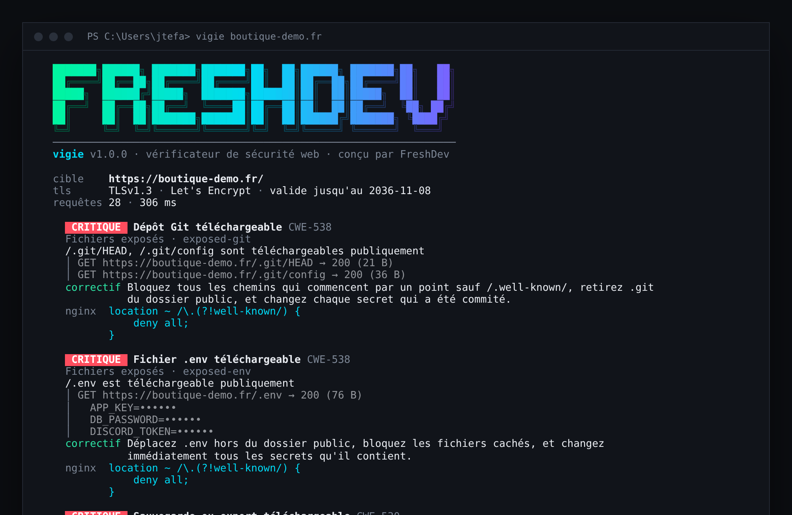
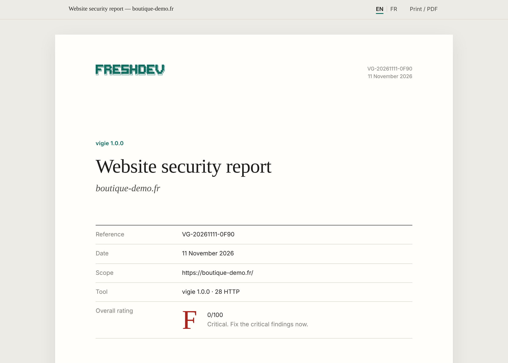
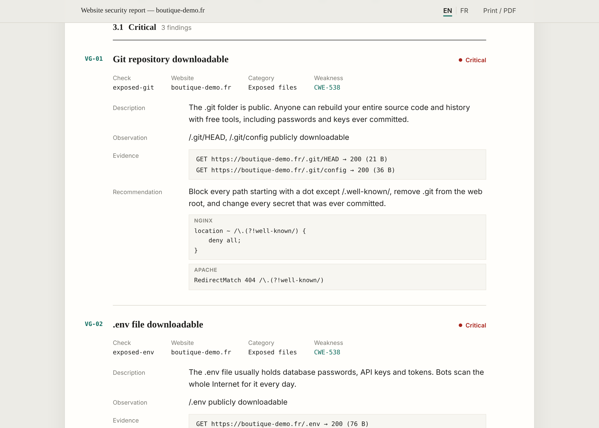

<div align="center">

# vigie

**Check the security of any website in seconds, and get a report your client can read.**

[](https://www.npmjs.com/package/vigie)
[](https://github.com/FreshlapeufDev/vigie/actions/workflows/ci.yml)
[](https://nodejs.org)
[](https://github.com/FreshlapeufDev/vigie/blob/main/LICENSE)

HTTPS · certificates · security headers · cookies · exposed files · vulnerable libraries

**English** · [Français](https://github.com/FreshlapeufDev/vigie/blob/main/README.fr.md)



</div>

## Why

Most websites are not hacked through clever exploits. They are hacked because a `.env` file is downloadable, the `.git` folder is public, a backup sits in the web root, cookies travel without `Secure`, or a ten-year-old jQuery still runs on the home page.

Bots scan the whole Internet for these mistakes every day. vigie finds them first, explains each one in plain language and gives you the exact line of nginx or Apache configuration that fixes it.

## Install

You need [Node.js](https://nodejs.org) 18 or newer (pick the **LTS** version).

```bash
npm install -g vigie
```

or run it once without installing:

```bash
npx vigie example.com
```

## Usage

```bash
vigie example.com
vigie https://shop.example.com --html audit.html
vigie example.com blog.example.com --lang fr
```

| Option | |
|---|---|
| `--html <file>` | standalone audit report in English and French |
| `--json` | machine-readable output |
| `--lang <en\|fr>` | output language (default: system language) |
| `--fail-under <grade>` | exit code `1` below this grade, for CI |
| `--no-probe` | only read the home page, skip the exposed-file checks |
| `--timeout <seconds>` | per request (default `10`) |
| `-q, --quiet` | summary only |
| `--no-banner` | hide the FreshDev logo |

## What it checks

| Severity | Check | What it catches |
|---|---|---|
| critical | `no-https` | the site has no working HTTPS |
| critical | `tls-invalid-cert` | expired, self-signed, incomplete or wrong-domain certificate |
| critical | `exposed-git` | `/.git/` downloadable: full source code and history |
| critical | `exposed-env` | `.env`, `.env.local`, `.env.production` downloadable |
| critical | `exposed-backup` | `.sql` dumps, `.zip` archives, `wp-config.php.bak`… |
| critical | `exposed-config` | `.vscode/sftp.json`, `.npmrc`, `docker-compose.yml` with secrets |
| critical | `exposed-htpasswd` | password file of protected areas |
| high | `tls-old-protocol` | server still accepts TLS 1.0 or 1.1 |
| high | `http-no-redirect` | `http://` serves the site instead of redirecting |
| high | `cors-reflected-origin` | any website can read authenticated responses |
| high | `insecure-form` | password form posted to `http://` |
| high | `exposed-phpinfo` | `phpinfo()` page online |
| medium | `tls-expiring` | certificate expires within 14 days (low within 30) |
| medium | `hsts-missing` | no `Strict-Transport-Security` |
| medium | `csp-missing` / `csp-unsafe` | no Content Security Policy, or one that still allows injected scripts |
| medium | `clickjacking` | page can be framed by any site |
| medium | `cookie-not-secure` | cookies without `Secure` (high for session cookies) |
| medium | `cookie-no-httponly` | session cookies readable by JavaScript |
| medium | `directory-listing` | folder content listed |
| medium | `mixed-content` | resources loaded over `http://` on an HTTPS page |
| medium | `outdated-library` | jQuery, Bootstrap, AngularJS, Lodash with known CVEs |
| medium | `insecure-redirect` / `cors-wildcard-credentials` / `exposed-server-status` | |
| low | `hsts-weak`, `nosniff-missing`, `referrer-policy`, `cookie-no-samesite`, `sri-missing`, `version-disclosure`, `exposed-ds-store` | |
| info | `permissions-policy-missing`, `security-txt-missing` | |

Every check carries its [CWE](https://cwe.mitre.org) identifier, an explanation and a fix with nginx and Apache examples.

## Rating

The score starts at 100 and loses 40, 20, 10 or 5 points per critical, high, medium or low finding.

| Grade | Meaning |
|---|---|
| **A+** | no finding above info |
| **A** | 90 and above |
| **B** | 75 and above |
| **C** | 60 and above |
| **D** | 40 and above |
| **F** | below 40, or any critical finding |

## HTML audit report

```bash
vigie example.com --html audit.html --lang fr
```

A single self-contained file, laid out like the report a security firm hands over: cover page with a reference, executive summary, priority actions, risk matrix, numbered findings (`VG-01`, `VG-02`…) with evidence and configuration examples, then the scope with the certificate, redirects and response headers of every site.

It switches between **English and French** in one click and prints to a clean A4 PDF.





## No false alarms

Many sites answer every address with their home page (React, Vue, WordPress with some plugins). A naive scanner then reports `.env` and `.git` as exposed everywhere. vigie only reports a file when its **content** matches what that file really looks like (`ref: refs/` for Git, `KEY=value` lines for `.env`, a ZIP signature for archives…), and compares every answer with a random page that should not exist.

Secrets found in exposed files are **never displayed**: only the variable names are shown, as `DB_PASSWORD=••••••`.

## Use it in CI

```yaml
- run: npx vigie https://staging.example.com --fail-under B
```

The job fails if the grade drops below B, for example after someone removes a security header.

## Be responsible

vigie only sends ordinary requests, like a browser: about thirty per site, never a form, never a login, never an attack. It is still a security tool: **only check websites you own or are allowed to test.** Use `--no-probe` to read the home page only.

## Development

```bash
git clone https://github.com/FreshlapeufDev/vigie
cd vigie
npm test
npm link
```

The tests start real HTTP and HTTPS servers on your machine: a deliberately vulnerable shop and a hardened single-page app. They need `openssl` to create the test certificates.

```
src/
├─ net.js          HTTP/HTTPS client: redirects, TLS details, compression, size limits
├─ checks/         transport, headers & cookies, exposed files, page content
├─ catalog.js      checks, severities, CWE, scoring, nginx/Apache examples
├─ i18n/           English and French
├─ report.js       console and JSON output
└─ html.js         audit report
```

No runtime dependency.

## Related

- [**fxguard**](https://github.com/FreshlapeufDev/fxguard) — security scanner for FiveM resources
- [**fxforge**](https://github.com/FreshlapeufDev/fxforge) — scaffold, lint and package FiveM resources

## License

MIT © FreshDev — Fresh&Dev
